# Campus Club Finder: Documentation

This walkthrough follows the app from its initial state through every page and feature. All screenshots are in `docs/screenshots/`.

## 1. Initial State

On first visit, localStorage is empty, so no club is joined. The app opens at `/` (Home) with the Navbar on top and the "Home" link highlighted.

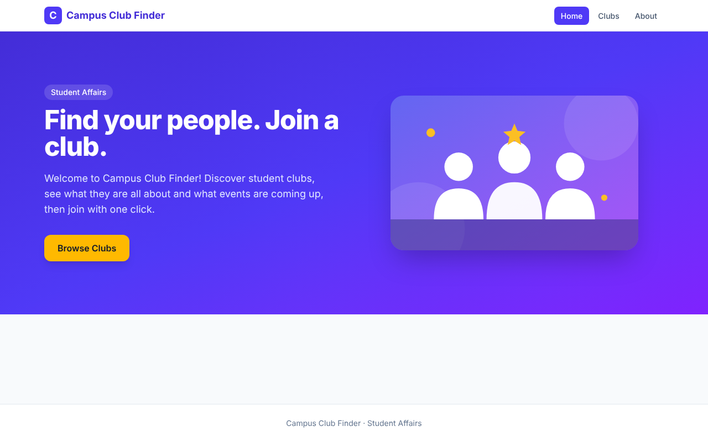

| Element | Behaviour |
| --- | --- |
| Navbar | Links to Home, Clubs, About; the current page is highlighted |
| Hero | Welcome message, short description, illustration |
| "Browse Clubs" button | Navigates to `/clubs` |

## 2. Club List (`/clubs`)

Shows all 5 clubs as cards. Default state: sorted Name A-Z, Grid View.

| Control | Options | Result |
| --- | --- | --- |
| Sort by (dropdown) | Name A-Z, Name Z-A | Re-orders cards alphabetically |
| View toggle | Grid View, List View | Grid: multi-column cards. List: cards stacked vertically |

### 2.1 Sorting Name Z-A

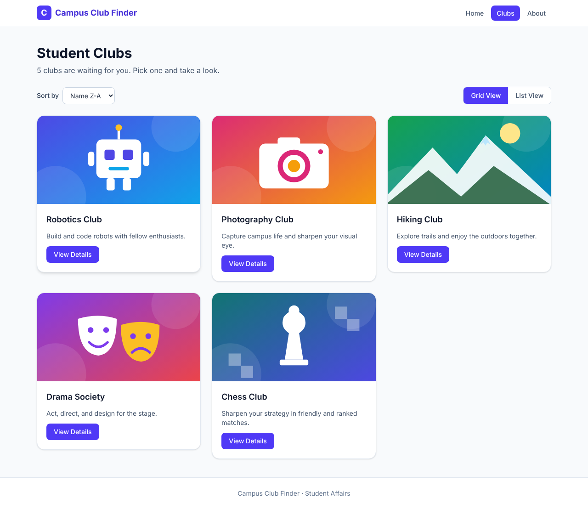

### 2.2 List View

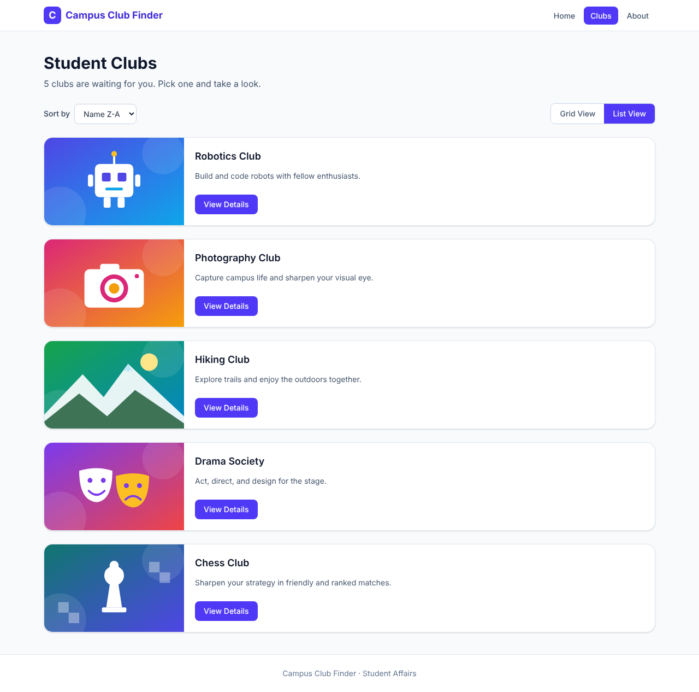

Each card shows the club image, name, short description, and a "View Details" button that opens the Club Detail page. Sort order and view mode are held in `useState` in `ClubList` and passed to `ClubControls` and `ClubCard` as props.

## 3. Club Detail (`/clubs/:clubId`)

Shows the big image, full description, and at least 2 upcoming events.

### 3.1 Not yet joined

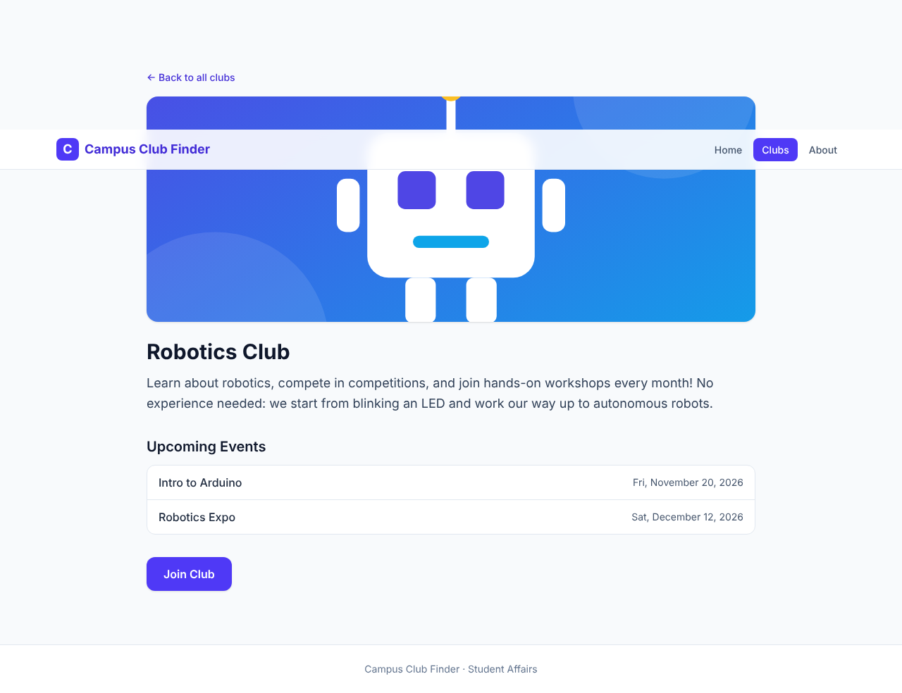

### 3.2 After clicking "Join Club"

The button is replaced by "You have joined this club!" and a confirmation message appears.

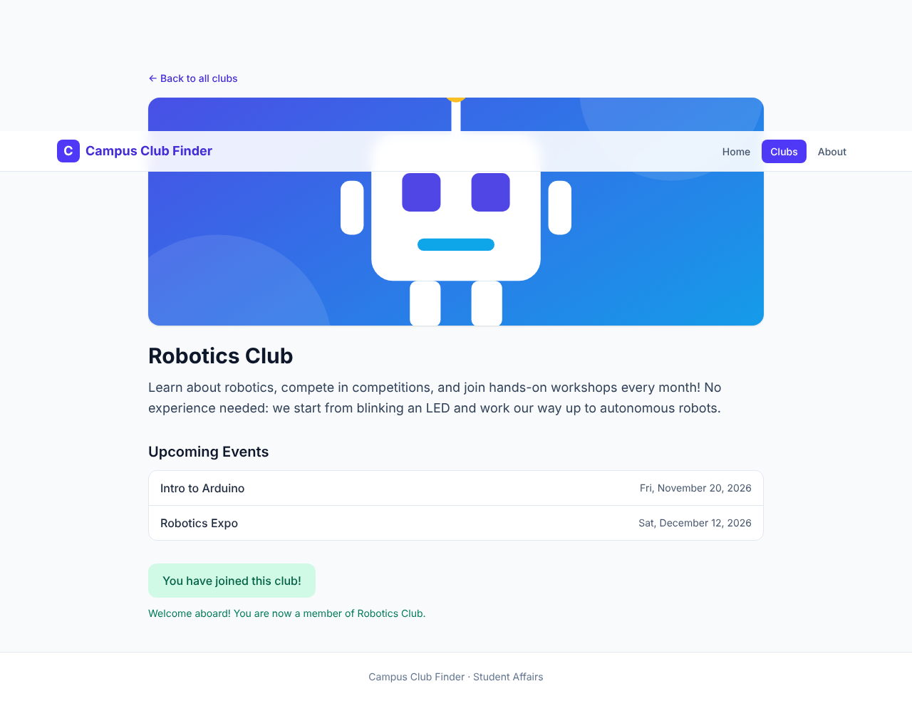

### 3.3 Persistence

The joined state is saved to localStorage (`campus-club-finder:joined`), so it survives a page reload.

The Club List also shows a "Joined" badge on joined clubs.

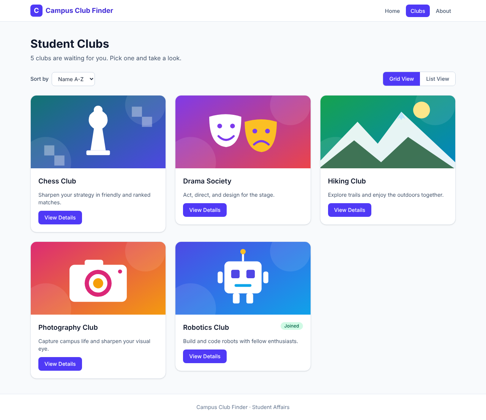

## 4. About (`/about`)

Explains what the app does and lists the tech stack.

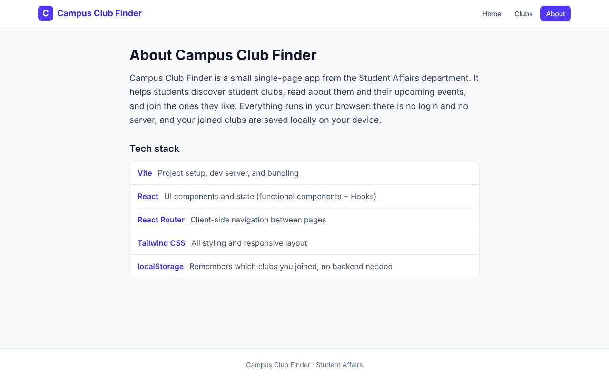

## 5. 404 Not Found (`*`)

Any unknown URL shows a friendly message and a "Back to Home" button. An unknown club id (e.g. `/clubs/unknown`) shows the same page.

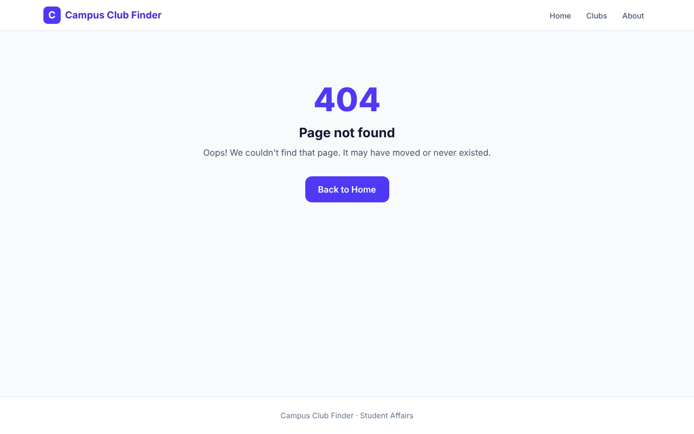

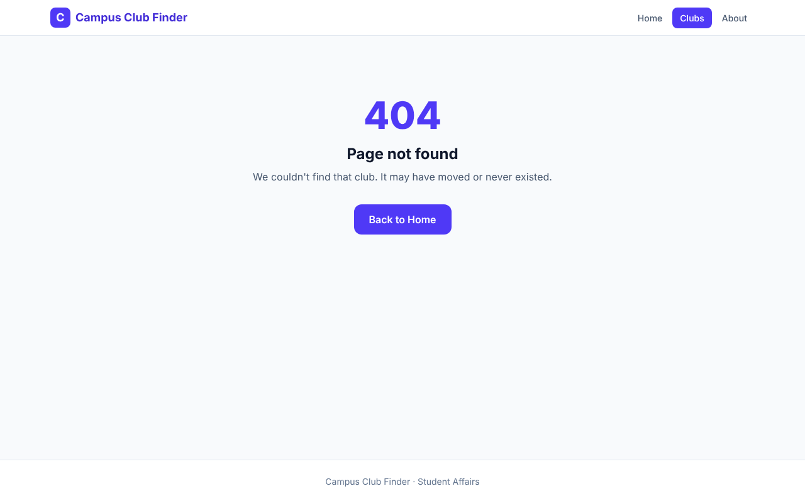

## 6. Responsive Layout (mobile, 390px wide)

| Page | Screenshot |
| --- | --- |
| Home | 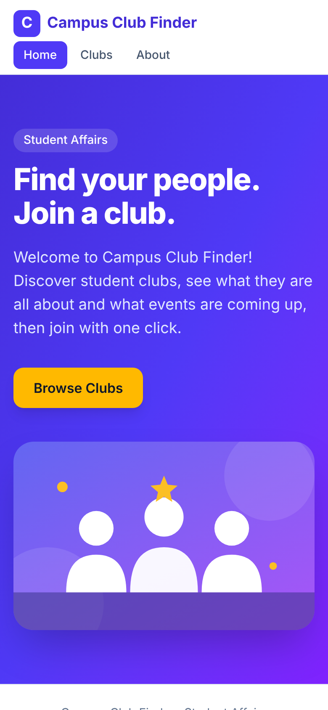 |
| Club List | 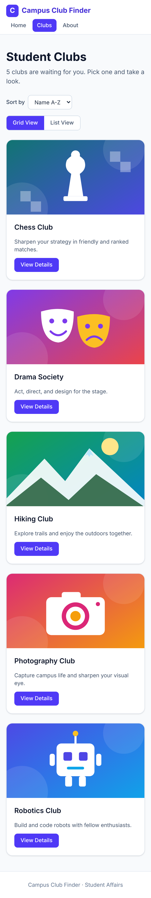 |
| Club Detail | 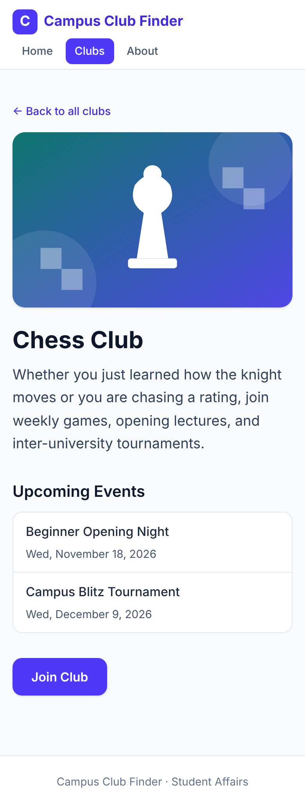 |

## 7. Accessibility Notes

| Feature | Detail |
| --- | --- |
| Skip link | "Skip to content" appears on keyboard focus |
| Landmarks | `header`, `nav`, `main`, `footer` |
| Focus styles | Visible focus ring on all links, buttons, and the dropdown |
| Toggle state | View buttons use `aria-pressed` |
| Join confirmation | Announced via `aria-live="polite"` |
| Images | Descriptive `alt` text |

## 8. Code Map

| File | Role |
| --- | --- |
| `src/data/clubs.js` | The 5 default clubs |
| `src/hooks/useJoinedClubs.js` | Reads/writes joined ids in localStorage |
| `src/components/Navbar.jsx` | Navigation with active-link highlight (`NavLink`) |
| `src/components/ClubControls.jsx` | Sort dropdown and view toggle |
| `src/components/ClubCard.jsx` | Club card (grid or list layout) |
| `src/pages/*` | Home, ClubList, ClubDetail, About, NotFound |
